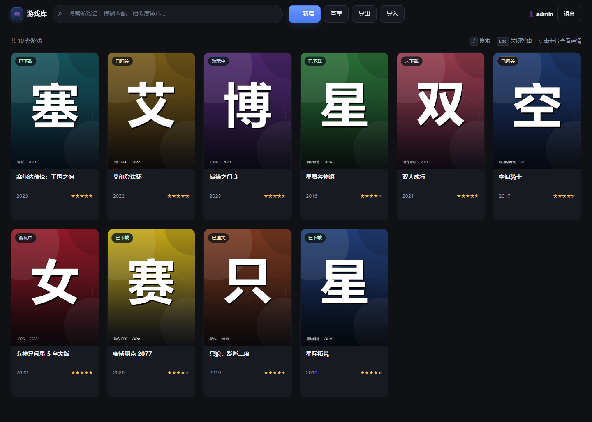
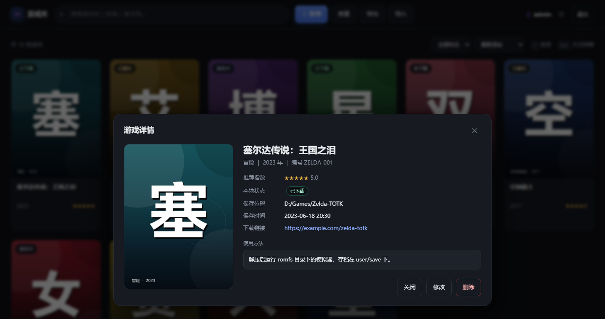
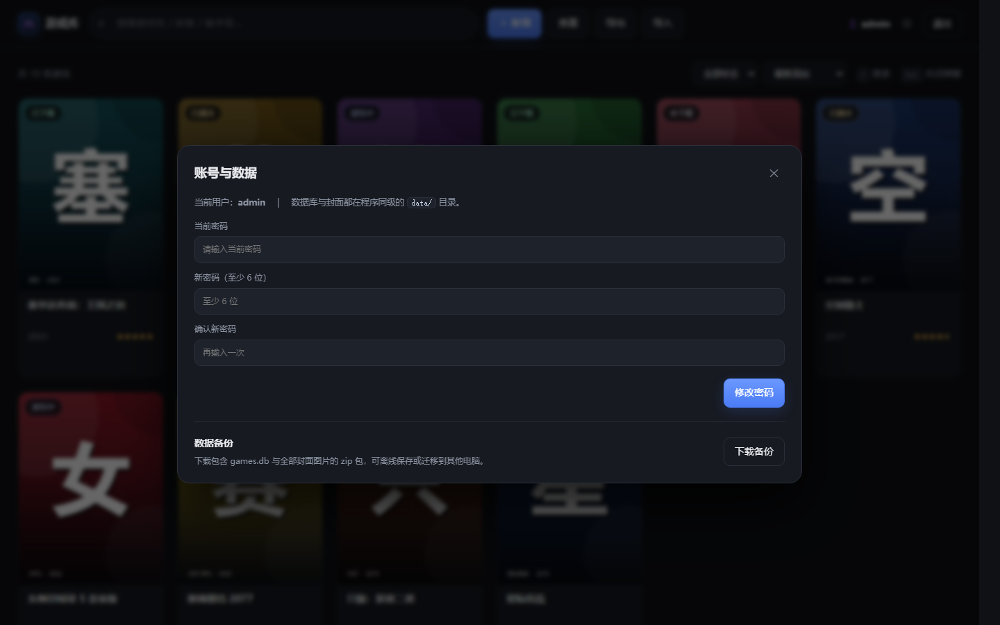
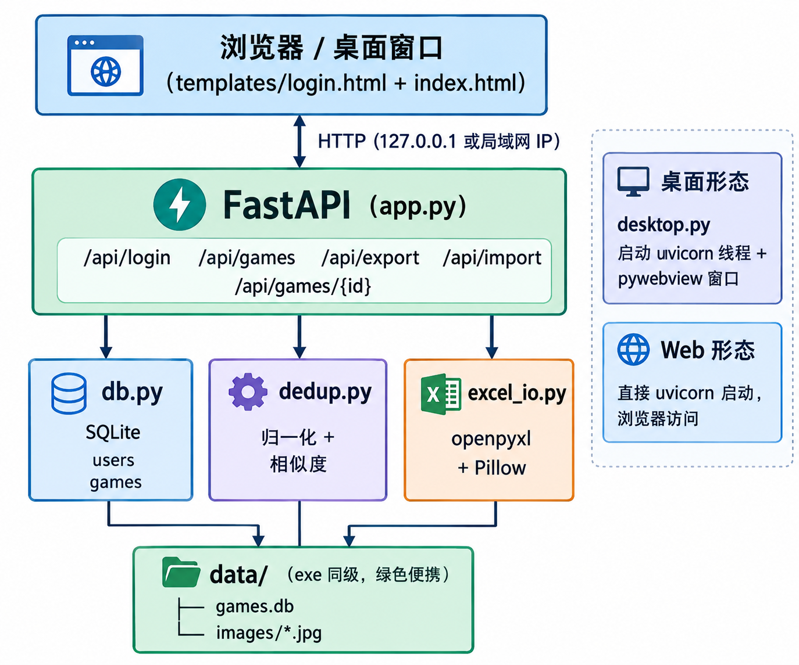

# 🎮 游戏库管理器

本地优先（local-first）的游戏资源管理工具：卡片式浏览、模糊搜索、相似去重、Excel 双向导入导出（含内嵌图片），
既可打包成**双击即用的 Windows exe**，也能以**网页登录**的方式在局域网共享。数据全部放在程序同级的 `data/` 文件夹里，拷走即迁移。

[](https://github.com/luoxue-self/GameManager)
[](https://github.com/luoxue-self/GameManager/releases)

仓库地址：<https://github.com/luoxue-self/GameManager>



> 第一次使用？请先看 **[使用指南.html](使用指南.html)**（图文版，双击即可阅读），
> 或 [使用指南.md](使用指南.md)。

## ✨ 功能

| 功能 | 说明 |
|---|---|
| 完整字段维护 | 游戏名、类型、编号、图片、保存时间、下载链接、使用方法、推荐指数、本地状态、游戏年份、保存位置 |
| 模糊搜索 | 顶部搜索栏，按归一化 + 相似度排序，「王国之泪」能搜到「塞尔达传说：王国之泪」 |
| 拼音搜索 | 支持全拼与首字母：`saierda`、`sai er da`、`sedc` 都能命中「塞尔达传说」 |
| 相似去重 | 名称归一化 + 相似度打分：≥85% 保存时拦截确认，60%–85% 仅提示 |
| 卡片 → 详情 | 点击卡片查看全部字段，详情内可直接修改 / 删除 |
| 筛选排序 | 按本地状态筛选，按最新添加 / 名称 / 评分 / 年份排序（网页模式会记住排序方式） |
| 封面图片 | 支持本地上传（自动压缩到长边 1200px）、图片 URL、文件名；图片需登录后访问 |
| Excel 导出 | 图片作为浮动对象内嵌到「游戏图片」列，可直接在 WPS / Excel 里看到 |
| Excel 导入 | 支持内嵌图片、文件名 + zip 图片包、外链三种来源；先预检再入库，重复条目可「跳过」或「更新已有」 |
| 全库查重 | 一键按 ≥85% 相似度分组，点击条目直达详情 |
| 账号安全 | scrypt 哈希 + 签名 Cookie；界面内可修改密码；忘记密码可双击 `重置密码.bat`；同一 IP 连续失败 8 次锁定 5 分钟 |
| 数据备份 | 一键下载包含 games.db 与全部封面的 zip，离线保存或迁移 |
| 两种形态 | `desktop.py` 原生窗口（pywebview） / `app.py` 网页模式 |
| 绿色便携 | 全部数据在 `data/`，整个文件夹拷贝即迁移 |

<details>
<summary>展开查看详情弹窗与「账号与数据」设置</summary>





</details>

## 🚀 快速开始

### 方式一：下载 exe（普通用户）

1. 到 [Releases](https://github.com/luoxue-self/GameManager/releases) 下载最新的
   `GameManager-v1.1.1-integration.zip`（整合包，含 exe、指南、源码），
   或单独下载 `GameManager-v1.1.1.exe`；
2. 解压到**桌面或 D 盘**（不要放 `C:\Program Files` 这类无写权限目录）；
3. 双击 `游戏库管理器.exe`；
4. 首次启动会自动生成管理员账号，密码写在 `data/初始密码.txt`，登录后请修改密码并删除该文件。

> ⚠️ 需要 Windows 10 1803+ / Windows 11（64 位）。
> 如果窗口空白，请安装 [Edge WebView2 Runtime](https://developer.microsoft.com/microsoft-edge/webview2/) 后重启程序。

### 方式二：从源码运行

要求 Python 3.10+。

#### 推荐：镜像安装器（国内网络自动加速）

`install.py` 会按顺序探测阿里云 / 清华 / 中科大 / 腾讯云 / 华为云等镜像，
自动选一个可用的完成安装：

```bash
python install.py                    # 自动探测可用镜像
python install.py --mirror tsinghua  # 指定镜像
python install.py --mirror aliyun --venv --dev --check
python install.py --index-url https://你的镜像/simple
```

Windows 也可以直接双击 `install.bat`。

| 参数 | 作用 |
|---|---|
| `--mirror auto/aliyun/tsinghua/ustc/tencent/huawei/pypi` | 选择镜像，默认 `auto` |
| `--index-url URL` | 自定义镜像（优先级最高，也识别环境变量 `PIP_INDEX_URL`） |
| `--venv` | 在项目下创建/复用 `.venv` 后安装 |
| `--dev` | 额外安装 pytest、httpx、markdown（生成指南用） |
| `--check` | 安装后做依赖导入自检 |
| `--build` | 安装后直接执行 `build.py` 打包 |
| `--save-config` | 把镜像写入当前用户的 pip 配置（会影响其他项目） |
| `--trusted-host HOST` | 镜像 HTTPS 证书有问题时使用 |
| `--timeout 60` | pip 网络超时秒数 |
| `--dry-run` | 只打印将执行的命令，不真正安装 |

#### 手动安装

```bash
python -m venv .venv
# Windows
.venv\Scripts\activate
# macOS / Linux
source .venv/bin/activate

pip install -r requirements.txt -i https://mirrors.aliyun.com/pypi/simple

python desktop.py     # 桌面窗口
# 或
python app.py         # 网页模式：http://127.0.0.1:8000
```

也可以把镜像永久写入 pip 配置：

```bash
pip config set global.index-url https://pypi.tuna.tsinghua.edu.cn/simple
```

首次运行会在终端打印管理员账号密码，同时写入 `data/初始密码.txt`。

### 局域网 / 公网访问

```bash
python app.py                                   # 0.0.0.0:8000
# 局域网：浏览器访问 http://那台机器的IP:8000
```

公网务必套 HTTPS，例如用 Caddy：

```bash
caddy reverse-proxy --from games.example.com --to 127.0.0.1:8000
```

## 🗂 数据、备份与升级

```
data/
├── games.db          # SQLite：users + games
├── images/           # 封面图片（uuid 命名）
├── .secret           # 会话签名密钥
├── 初始密码.txt       # 仅首次生成时写入，登录后可删除
└── 启动日志.txt       # 桌面入口的启动/异常日志（无控制台 exe 排查用）
```

- **备份**：拷走整个 `data/` 即可；也可以用「导出 Excel」（图片已内嵌）。
- **升级程序**：只覆盖 exe 与 `_internal/`，**保留 `data/`**。
- **迁移电脑**：整个程序文件夹拷到新机器，双击 exe，数据还在。
- ⚠️ 不要多人同时共享同一份 `data/` 文件夹（SQLite 会锁冲突）。多人使用请走 Web 模式，由一台机器常驻服务。

## 📥 Excel 导入格式

导出文件的第一行即标准表头：

```
游戏名 | 游戏类型 | 游戏编号 | 游戏图片 | 保存时间 | 下载链接 | 使用方法 | 推荐指数 | 本地状态 | 游戏年份 | 保存位置
```

导入时兼容这些别名：`名称/游戏名称`、`类型`、`编号`、`图片/封面`、`时间`、`链接`、`说明`、`评分`、`状态`、`年份`、`位置`。
表头可以在前 10 行内任意位置（会自动跳过标题行），但**必须包含「游戏名」列**。

封面有三种来源：

| 方式 | Excel 里怎么填 | 说明 |
|---|---|---|
| A 内嵌 | 图片插入到「游戏图片」列 | 最常用，按图片锚点行号回填 |
| B 文件名 | 写 `zelda.jpg`，同时选择 zip 图片包 | 按文件名匹配压缩包内图片 |
| C 外链 | 写 `https://…` | 不下载，原样存库 |

导入流程分两步：**预检**只统计不写库，确认后再执行。重复条目默认**跳过**，
也可以在导入弹窗里切换为**更新已有条目**（覆盖字段、保留原封面），适合重新导入修订后的表格。

> WPS 导出的 xlsx 偶尔出现图片锚点偏移。遇到错行时先用预检核对行号，或改用「文件名 + zip」方式。
> 表头可以不在第一行（前 10 行内自动查找），工作簿里有多张表时会自动选含「游戏名」的那张。

## 🔌 API 一览

| 方法 | 路径 | 说明 |
|---|---|---|
| POST | `/api/login` | 登录，写入会话 Cookie |
| POST | `/api/logout` | 退出登录 |
| GET | `/api/me` | 当前用户 |
| GET | `/api/games?q=` | 列表 / 模糊搜索（带 `score` 相似度） |
| GET | `/api/games/duplicates` | 全库查重分组 |
| GET | `/api/games/{id}` | 详情 |
| POST | `/api/games` | 新增（高度相似会返回 409，可带 `force: true`） |
| PUT | `/api/games/{id}` | 修改（只更新传入字段，相似仅提示） |
| DELETE | `/api/games/{id}` | 删除（同时清理无人引用的封面） |
| GET | `/images/{filename}` | 封面图（需登录） |
| POST | `/api/upload` | 上传封面，返回文件名 |
| POST | `/api/password` | 修改当前账号密码（需验证旧密码） |
| GET | `/api/backup` | 下载数据备份 zip（games.db + images） |
| GET | `/api/export/excel` | 导出 xlsx（含内嵌图片） |
| POST | `/api/import/excel` | 导入 xlsx + 可选 zip 图片包，支持 `on_dup=skip/update` |
| GET | `/api/health` | 健康检查（桌面端等端口就绪用） |

交互式文档：启动后访问 `http://127.0.0.1:8000/docs`。

## 🧱 技术选型

| 层 | 选型 | 理由 |
|---|---|---|
| 后端 | FastAPI + uvicorn | 异步、自带 OpenAPI，前后端一套 |
| 数据库 | SQLite（标准库 sqlite3） | 零依赖、单文件、便携 |
| 搜索 | pypinyin + 自研归一化/相似度 | 中文模糊匹配、拼音全拼与首字母 |
| 桌面外壳 | pywebview | 复用 Web 前端，体积小 |
| 打包 | PyInstaller（onedir） | 启动快、路径稳定 |
| Excel | openpyxl + Pillow | 读写 xlsx、内嵌图片锚定 |
| 认证 | itsdangerous 签名 Cookie + scrypt | 无状态、够用 |
| 前端 | 原生 HTML/CSS/JS | 无构建步骤、单文件维护 |
| CI | GitHub Actions | 自动测试 + 打包 Windows exe |

## 🏗 架构



- 浏览器 / pywebview 窗口共用同一套 `templates/` 页面，访问同一套 REST API；
- `db.py`（SQLite）、`dedup.py`（归一化 + 相似度）、`excel_io.py`（openpyxl + Pillow）各自独立，方便单测；
- 桌面形态只是在 FastAPI 外面套了一层窗口，数据目录统一由 `GAME_DATA_DIR` 指定。

## 📦 打包

```bash
python build.py            # 产物在 dist/游戏库管理器/
```

> ⚠️ `build.py` 会先清空 `dist/` 再打包。如果 `dist/游戏库管理器/` 里已经在存数据，
> 请先备份 `dist/游戏库管理器/data/`，打包完成后放回。

发布用的整合包（exe + 文档 + 源码）可以这样生成：

```bash
python tools/build_guide.py       # 生成自包含的 使用指南.html
python tools/make_package.py      # 产物在 release/游戏库管理器-v1.1.1-整合包.zip
```

`build_guide.py` 需要 `markdown`（`python install.py --dev` 会一并安装）。

打包产物：

```
dist/游戏库管理器/
├── 游戏库管理器.exe
├── _internal/          ← 运行时依赖
└── data/               ← 首次运行后生成的数据
    └── images/
```

推送到 `main` 或打 `v*` 标签时，GitHub Actions 会自动测试并打包；打标签还会把 exe 挂到 Release。

## 🧪 测试

```bash
pip install pytest httpx
python -m pytest -q
```

覆盖（32 个用例）：归一化 / 相似度阈值、拼音全拼与首字母、管理员与表结构、编号唯一索引、
Excel 导出→清库→导入往返（含内嵌图片）、zip 图片匹配、分表表头、缺表头报错、导入更新模式、
登录鉴权、图片鉴权、增删改查、409 判重、上传、查重、导出、导入预检、密码修改、数据备份、损坏 xlsx 报错、安全响应头、
镜像源选择与 pip 命令拼装。

## 🛠 目录结构

```
game-manager/
├── desktop.py                 # 桌面入口（uvicorn 线程 + pywebview）
├── app.py                     # FastAPI 应用
├── db.py                      # SQLite / 密码哈希 / 初始管理员
├── dedup.py                   # 归一化 + 相似度
├── excel_io.py                # Excel 导入导出
├── templates/
│   ├── login.html
│   └── index.html
├── assets/icon.ico
├── docs/                      # 架构图、界面截图、完整性检查报告
├── tests/                     # pytest 用例
├── tools/                     # 指南生成 / 整合包构建脚本
├── data/                      # 运行时数据（不进 Git）
├── install.py                 # 镜像源依赖安装器
├── install.bat                # Windows 双击安装
├── 重置密码.bat                # 忘记密码时双击重置（exe 用户）
├── 使用指南.md                 # 面向普通用户的图文指南
├── 使用指南.html               # 自包含图文指南（双击阅读）
├── pyinstaller.spec
├── build.py
├── requirements.txt
├── LICENSE
├── .github/workflows/build.yml
├── IMPLEMENTATION.md          # 完整实现文档（按阶段）
└── README.md
```

## ❓ 常见问题

**Q：双击 exe 窗口空白 / 报错？**
先看 `data/启动日志.txt` 里记录的异常；窗口空白通常是缺 Edge WebView2 Runtime，安装后重启程序。

**Q：提示「无法写入 data 目录」？**
程序被放在 `C:\Program Files` 等无写权限位置，移到桌面或 D 盘。

**Q：杀毒软件报毒？**
PyInstaller 打包的 exe 常见误报，加白名单，或用源码自行打包。

**Q：pip 安装很慢 / 超时？**
用镜像安装器：`python install.py --mirror aliyun`；仍然失败可以换 `--mirror tsinghua`，
或加 `--trusted-host mirrors.aliyun.com`、`--index-url https://你的镜像/simple`。
只使用打包 exe 的话不需要安装任何 Python 依赖。

**Q：忘记管理员密码？**
如果还能进入界面：点右上角 ⚙ → 修改密码。
完全忘记时：双击程序目录里的 `重置密码.bat`，会重置为随机密码并弹窗显示，同时写入 `data/初始密码.txt`。
源码运行也可以执行 `python desktop.py --reset-password`（可跟新密码），或 `python -c "import db; db.set_password('admin','新密码')"`。

**Q：怎么备份 / 恢复到另一台电脑？**
界面右上角 ⚙ → 「下载备份」，会得到一个包含 `games.db` 和全部封面的 zip。
恢复时关闭程序，把 zip 里的 `games.db` 与 `images/` 覆盖到程序同级 `data/` 后重新启动。

**Q：图片不显示，或直接打开 /images/… 提示未登录？**
这是有意的：封面图也要求登录，只有当前浏览器会话能访问。重新登录即可。

**Q：能直接在 macOS / Linux 用吗？**
Windows exe 不行；源码可以运行（pywebview 跨平台，Linux 需 `libwebkit2gtk-4.1-dev`），
桌面窗口依赖 `pywebview`，也可只用 `python app.py` 走浏览器。

## 📝 更新日志

### v1.1.1

- 修复：Excel 导入「更新已有条目」时，库中有多条近似记录会反复匹配同一条；现在优先完全同名，再按相似度取最佳匹配
- 修复：新增/编辑弹窗里「游戏名」必填星号换行的问题
- 新增：`重置密码.bat` / `desktop.py --reset-password`，exe 用户忘记密码也能自助恢复
- 完整性检查：41 项真实 API 验收、32 个单测、打包 exe 与整合包复测通过
- 新增面向普通用户的《使用指南》与整合包（exe + 文档 + 源码）

### v1.1.0

- 新增**拼音搜索**：全拼（`saierda`）、带空格全拼（`sai er da`）、首字母（`sedc`）都能命中；老数据启动时自动回填拼音
- 新增**账号与数据**弹窗：修改密码、下载整库备份 zip；忘记密码不用再改数据库
- 新增**筛选与排序**：按本地状态筛选，按最新添加 / 名称 / 评分 / 年份排序（排序方式本地记忆）
- Excel 导入支持**更新已有条目**（保留原封面），预检与结果里分别统计「可更新 / 已更新」
- 封面图片改为**登录后访问**，不再暴露公开静态目录；API 加 `no-store` 与常用安全响应头
- 损坏 / 非 xlsx 文件返回可读的 400 提示，而不是 500
- 新增 **`install.py` 镜像源安装器**：自动探测阿里云 / 清华 / 中科大 / 腾讯云 / 华为云，支持 `--venv`、`--dev`、`--check`、`--build`、`--save-config`
- 测试扩充到 31 个，打包版重新验证登录、拼音搜索、备份与密码修改

### v1.0.0

- FastAPI + SQLite + pywebview 完整实现，含模糊搜索、相似去重、Excel 双向导入导出、桌面 exe 与 CI

## ✅ 完整性检查

- v1.1.1 检查报告：[docs/完整性检查报告.md](docs/完整性检查报告.md)
- 32 个自动化测试、41 项真实 API 验收、界面走查、打包 exe 与整合包复测均通过
- 面向普通用户的图文指南：[使用指南.html](使用指南.html) ｜ [使用指南.md](使用指南.md)

## 🌐 GitHub 发布

- 仓库：<https://github.com/luoxue-self/GameManager>
- 上传与发布指南：[docs/GitHub上传指南.md](docs/GitHub上传指南.md)
- 推送 `main` 会自动跑测试和打包；打 `v*` 标签会自动创建 Release 并附上 Windows exe。

## 📄 License

MIT
