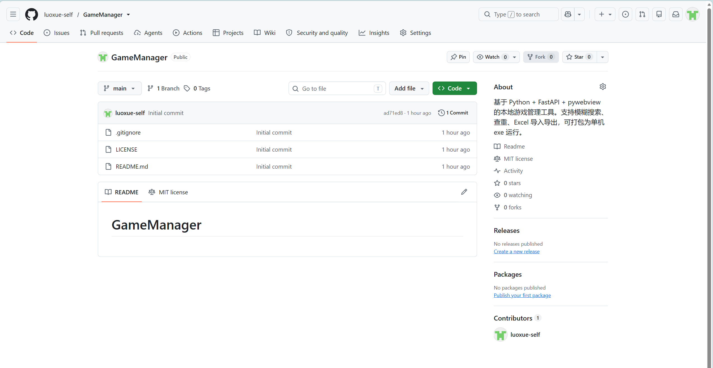

# GitHub 上传与发布指南

本文档按 **本项目（GameManager）的实际情况** 整理，参考了《GameManager上传参考指南.md》，
并针对“本地已有完整 Git 历史、远程已有 GitHub 初始提交”的情况做了调整。

- 仓库：<https://github.com/luoxue-self/GameManager>
- 可见性：Public
- 默认分支：`main`
- 当前目标版本：`v1.1.1`
- 初始仓库状态（GitHub 自动生成 README / .gitignore / LICENSE）：



---

## 0. 先明确本项目的实际情况

与“从零建仓库”不同，本项目已经具备：

- 本地已有完整代码和 4 个提交（v1.0.0 → v1.1.1），分支为 `main`；
- 远程仓库由 GitHub 网页创建，已经有一个 `Initial commit`（`ad71ed8`），包含
  `.gitignore`、`LICENSE`、`README.md`；
- 本地与远程是两条**无关历史**，不能直接 `git push`，也不能重复 `git init`。

因此正确做法是：**保留远程初始提交 → 合并到本地 → 用本地文件解决冲突 → 再推送**。
不要 `git push --force`，否则会丢掉远程的初始提交记录。

---

## 1. 上传前安全检查

`.gitignore` 已包含：

```gitignore
__pycache__/
*.py[cod]
.venv/
venv/
env/
data/*
!data/.gitkeep
.secret
*.db
build/
dist/
release/
.pytest_cache/
.vscode/
.idea/
```

检查即将提交的文件：

```powershell
git status
git ls-files
```

**绝对不能出现**：

- `data/games.db`、`data/.secret`、`data/初始密码.txt`
- `.venv/`、`__pycache__/`
- `dist/`、`build/`、`release/`
- 任何 GitHub Token、密码文件

如果曾经误提交过，执行：

```powershell
git rm -r --cached .
git add .
git commit -m "chore: 修正 gitignore"
```

本项目的 `release/游戏库管理器-v1.1.1-整合包.zip` 是本地发布产物，已在 `.gitignore` 中排除；
GitHub 上的 exe 由 Actions 构建，不需要提交几十 MB 的 zip。

---

## 2. 关联远程仓库

```powershell
cd D:\DeepSeek\deepseek-workspace\GameManager

git remote add origin https://github.com/luoxue-self/GameManager.git
git remote -v
```

如果本机访问 GitHub 需要代理（本机 Clash 在 `127.0.0.1:7897`），只给当前仓库配置即可：

```powershell
git config http.proxy http://127.0.0.1:7897
git config https.proxy http://127.0.0.1:7897
```

> `.git/config` 不会提交到仓库；换一台机器需要重新配置。

确认远程可读：

```powershell
git fetch origin main
git log --oneline origin/main -3
```

---

## 3. 合并远程初始提交（关键）

```powershell
git merge origin/main --allow-unrelated-histories
```

因为两边都有 `README.md`、`LICENSE`、`.gitignore`，会出现 add/add 冲突。
**保留本地版本**（本地 README 才是项目说明）：

```powershell
git checkout --ours README.md LICENSE .gitignore
git add README.md LICENSE .gitignore
git status
```

确认没有其他冲突后：

```powershell
git commit -m "merge: 合并 GitHub 初始仓库"
```

合并后的历史会同时保留 `ad71ed8`（GitHub 初始提交）和本地的 v1.0.0–v1.1.1 提交，
之后就可以正常快进/推送，不需要 force。

---

## 4. GitHub 身份认证

本机没有预存 GitHub 凭据时，`git push` 会弹出 Git Credential Manager（GCM）登录窗口，
按提示用 `luoxue-self` 账号登录并授权即可。

也可以使用设备码方式（适合没有浏览器弹窗的环境）：

```powershell
git credential-manager github login --device --no-ui
```

或者使用 Personal Access Token（PAT）：

- 头像 → Settings → Developer settings → Personal access tokens
- 需要 `repo` 权限；如果推送 `.github/workflows/`，还需要 `workflow` 权限
- 不要把 Token 写进 README、脚本或仓库；用完可在 GitHub 撤销

> 本次上传使用 GitHub OAuth 设备码完成授权，未把任何 Token 写入项目文件。

---

## 5. 推送代码

```powershell
git push -u origin main
```

推送成功后会看到类似：

```
branch 'main' set up to track 'origin/main'.
```

到 GitHub 刷新仓库，应能看到 `app.py`、`templates/`、`tests/`、`tools/`、
`使用指南.html` 等完整文件，以及 `README.md` 中的项目介绍和截图。

---

## 6. 打标签并触发自动打包

本项目 `.github/workflows/build.yml` 已配置：

- push 到 `main`：运行 pytest + Windows 打包（artifact）
- push `v*` 标签：额外自动创建 Release，并附上 `游戏库管理器.exe`

发布 v1.1.1：

```powershell
git tag -a v1.1.1 -m "v1.1.1: 拼音搜索、账号与数据、完整性检查与使用指南"
git push origin v1.1.1
```

然后打开：

- Actions：<https://github.com/luoxue-self/GameManager/actions>
- 等待 `Build Windows EXE` 的 test + build 两个 job 变绿
- Releases：<https://github.com/luoxue-self/GameManager/releases>

如果 Release 没有自动附件，到 Actions 对应 run 下载 `game-manager-windows` artifact，
手动拖到 Release 的附件区域即可。

---

## 7. 发布说明建议

Release 标题：`v1.1.1 完整性检查与使用指南`

正文可直接使用：

```markdown
## 游戏库管理器 v1.1.1

### 新增
- 拼音全拼 / 首字母搜索
- 修改密码、整库 zip 备份
- 状态筛选与多字段排序
- Excel 导入「跳过 / 更新已有」两种模式
- 使用指南（HTML / Markdown）与整合包
- 重置密码.bat，忘记密码可自助恢复

### 修复
- 导入更新时多条近似记录匹配错误
- 编辑弹窗「游戏名 *」星号换行

### 下载
- `游戏库管理器.exe`（Windows 10 1803+ / 11，需要 WebView2）
- 解压后双击，首次启动密码见 `data/初始密码.txt`

### 数据安全
- 所有数据都在本地 data 文件夹
- 不联网、不上传、不收集任何信息
```

---

## 8. 常见问题

| 问题 | 解决 |
|---|---|
| `Recv failure: Connection was reset` | 本机直连 GitHub 被重置；配置代理：`git config http.proxy http://127.0.0.1:7897` |
| `refusing to merge unrelated histories` | 加 `--allow-unrelated-histories` 再 merge |
| README/LICENSE/.gitignore 冲突 | 用 `git checkout --ours ...` 保留本地版本后 `git add` |
| `403` / 没有权限 | 检查登录账号是否为 `luoxue-self`；PAT 是否有 `repo` + `workflow` |
| push 后 Actions 不运行 | 确认标签以 `v` 开头，且 `.github/workflows/build.yml` 已推送 |
| Release 里没有 exe | 下载 Actions artifact 手动上传，或检查 step 日志 |
| 中文路径打包失败 | workflow 文件必须 UTF-8；本地已验证 `dist/游戏库管理器/游戏库管理器.exe` 可构建 |

---

## 9. 本次上传记录

- 仓库：<https://github.com/luoxue-self/GameManager>
- 默认分支：`main`
- 目标标签：`v1.1.1`
- 本地提交：`1bea3cf`（完整性检查、使用指南、整合包工具）
- 远程初始提交：`ad71ed8`
- Actions：<https://github.com/luoxue-self/GameManager/actions>
- Releases：<https://github.com/luoxue-self/GameManager/releases>

> 推送完成后，可在本文件补充实际 merge commit、Actions run 链接和 Release 链接。
