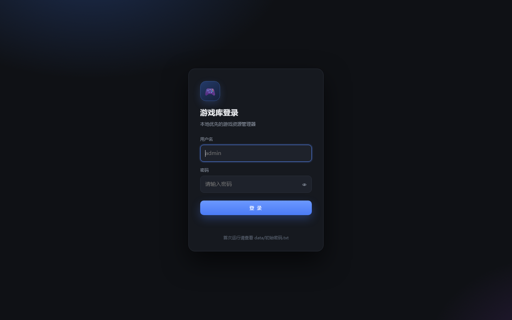
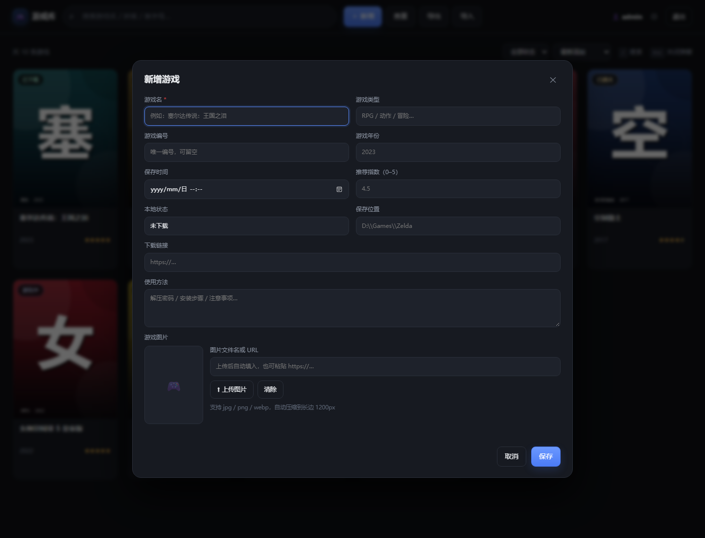
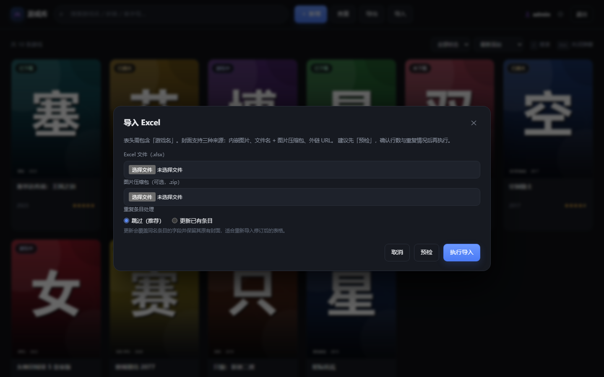

# 游戏库管理器 · 使用指南

> **版本 v1.1.1** ｜ 适用于 Windows 10（1803 及以上）/ Windows 11（64 位）
>
> 一句话：把散落在硬盘、网盘、论坛里的游戏，整理成一张张看得见的卡片。
> 找游戏、查重复、导 Excel、换电脑，都不用再翻聊天记录。


[TOC]

---

## 1. 这个工具能帮你做什么？

如果你有这些烦恼，它正好合适：

- 游戏太多，记不清哪个在 D 盘、哪个在移动硬盘、哪个还在网盘里；
- 下载链接、解压密码、安装方法散落在各个 txt 和聊天记录里；
- 想用 Excel 管，但图片放不进去，换台电脑就乱了；
- 同一款游戏存了好几份，名字还写得不一样，根本查不出来。

游戏库管理器把这些信息集中到一个本地小工具里：

| 你想要的 | 它可以做到 |
|---|---|
| 像书架一样看游戏 | 封面卡片墙，点开看全部信息 |
| 快速找到某个游戏 | 中文、英文、拼音全拼、拼音首字母都能搜 |
| 避免重复收藏 | 保存时自动提示相似条目；还能一键全库查重 |
| 批量整理 | 从 Excel 导入，图片也能一起进来 |
| 备份 / 分享清单 | 导出 Excel（图片内嵌）；一键下载整库备份 |
| 数据自己做主 | 所有数据都在程序旁边的 `data` 文件夹里，拷走即迁移 |

> 💡 **不需要联网，也不需要注册账号。** 程序本身不会上传你的数据。
> 只有你主动使用「图片 URL」时，浏览器才会去加载那张网络图片。

---

## 2. 第一次使用：3 分钟上手

### 第 1 步：解压到合适的位置

把整合包解压到**桌面**或 **D 盘**，例如：

```
D:\游戏\游戏库管理器\
```

解压后应该能看到：

```
游戏库管理器.exe
_internal\            ← 程序运行需要的文件，别删
使用指南.html          ← 就是本指南
重置密码.bat           ← 忘记密码时用
data\                 ← 你的游戏数据（首次启动后生成）
```

> ⚠️ **不要**放在 `C:\Program Files`、`C:\Windows` 这类没有写入权限的目录，
> 否则程序无法创建 `data` 文件夹。也**不要**直接在压缩包里双击 exe。

### 第 2 步：双击启动

双击 **`游戏库管理器.exe`**。

- 第一次启动会慢几秒，之后会快很多；
- 如果弹出「缺少 WebView2」或窗口一片空白，请先安装
  [Microsoft Edge WebView2 Runtime](https://developer.microsoft.com/microsoft-edge/webview2/)，
  装完再重新打开程序；
- 如果 Windows 弹出防火墙提示，本机使用选「取消」也能正常用（只有网页模式共享给别人时才需要放行）。

### 第 3 步：找到初始账号和密码

第一次启动后，程序会在 exe 旁边生成 `data` 文件夹，里面有一个：

```
data\初始密码.txt
```

用**记事本**打开它，会看到：

```
用户名：admin
密　码：xxxxxxxxxx
```

回到登录窗口：

- 用户名填 `admin`
- 密码填文件里的那一串（注意区分大小写）
- 点「登录」



> 找不到 `data\初始密码.txt`？
> 说明程序没有成功启动或没有写入权限。先看 `data\启动日志.txt`，或参考第 9 节 FAQ。

### 第 4 步：把初始密码改掉

登录后，点右上角的 **⚙** 图标，打开「账号与数据」：

1. 输入当前密码（就是刚才文件里的那一串）；
2. 输入两遍新密码（至少 6 位）；
3. 点「修改密码」。


改完之后，可以顺手把 `data\初始密码.txt` 删掉，避免别人看到。
以后忘记密码也不用慌，双击程序目录里的 **`重置密码.bat`** 即可（见第 8 节）。

### 第 5 步：添加第一个游戏

点左上角的 **「＋ 新增」**，至少填一个**游戏名**就能保存。
建议顺手把类型、年份、评分、封面也填上，卡片会好看很多。



封面有两种填法：

- **上传图片**（推荐）：点「⬆ 上传图片」，选一张 jpg / png / webp，程序会自动压缩；
- **图片链接**：直接粘贴 `https://...` 开头的网络图片地址。

填好后点「保存」，主界面就会出现第一张卡片。

---

## 3. 界面一眼看懂

### 顶部工具栏

| 按钮 | 作用 |
|---|---|
| 搜索框 | 输游戏名、英文、拼音或首字母，边打边搜 |
| **＋ 新增** | 添加一个游戏 |
| 查重 | 找出全库里名字很像的条目 |
| 导出 | 把整个游戏库导出成 Excel |
| 导入 | 从 Excel 批量导入（可带图片） |
| ⚙ | 修改密码、下载整库备份 |
| 退出 | 退出登录，回到登录页 |

### 第二行

- 左边显示「共 N 条游戏」；搜索或筛选后会变成「搜索到 N 条 / 筛选 X 条」；
- 右边可以按**本地状态**筛选，按**最新添加 / 名称 / 评分 / 年份**排序；
- 快捷键：`/` 聚焦搜索框，`Esc` 关闭弹窗。

### 卡片怎么读

一张卡片从上到下是：

- **封面**：没有封面时显示一个手柄图标；
- **左上角的小标签**：本地状态（未下载 / 已下载 / 游玩中 / 已通关 / 已弃坑）；
- **游戏名**：最多显示两行；
- **年份**和**星级**：星级就是推荐指数，半颗星也会显示；
- 鼠标移到卡片上，会出现「修改 / 删除」按钮；
- **点卡片任意位置**，打开详情弹窗。

---

## 4. 日常操作

### 4.1 添加或修改游戏

点「＋ 新增」或卡片上的「修改」，会打开表单。字段都不难：

| 字段 | 必填 | 说明 | 例子 |
|---|---|---|---|
| 游戏名 | ✅ | 卡片标题，也是搜索重点 | 塞尔达传说：王国之泪 |
| 游戏类型 | | 自由填，可下拉选常见类型 | 冒险 / RPG |
| 游戏编号 | | **不能重复**，可当收藏编号 | ZELDA-001 |
| 游戏年份 | | 发售年份 | 2023 |
| 保存时间 | | 资源保存到本地的日期时间 | 2024-05-01 10:00 |
| 推荐指数 | | 0～5 分，可以填半星（如 4.5） | 4.5 |
| 本地状态 | | 未下载 / 已下载 / 游玩中 / 已通关 / 已弃坑，也可自己写 | 已下载 |
| 保存位置 | | 在哪个盘 / 哪个文件夹 | D:\Games\Zelda |
| 下载链接 | | 网盘、论坛等地址；详情里可点开 | https://... |
| 使用方法 | | 解压密码、安装步骤、注意事项，支持多行 | 解压密码 1234 |
| 游戏图片 | | 上传图片，或填文件名 / 网络 URL | 见上一节 |

保存时如果提示「疑似重复」，说明库里有名字很像的游戏：

- 确认不是同一个，再点「确定」继续保存；
- 如果是同一个，点「取消」，回到库里直接修改已有条目。

> 💡 编号是唯一值。两个游戏填同一个编号时，后保存的会被拒绝。

### 4.2 搜索：中文、英文、拼音都行

在顶部搜索框输入，停顿一下就会自动搜索。支持的写法：

| 你输入 | 能搜到 |
|---|---|
| `王国之泪` | 塞尔达传说：王国之泪（名字包含即可） |
| `塞尔达` | 塞尔达传说：王国之泪 |
| `saierda` | 塞尔达传说：王国之泪（全拼） |
| `sai er da` | 同上（带空格也没关系） |
| `sedc` | 同上（每个字的拼音首字母） |
| `elden` | Elden Ring（库里存的是英文名时） |
| `aierdeng` | 艾尔登法环（全拼） |

搜索结果按相似度从高到低排，卡片右上角会显示「相似 92%」这样的提示。
点搜索框右侧的 **✕** 可以清空；键盘按 `/` 可以直接跳到搜索框。

### 4.3 筛选和排序

- **筛选**：右侧「全部状态」下拉里选一个状态，只显示这一类；
- **排序**：「最新添加 / 名称 A→Z / 评分从高到低 / 年份从新到旧」；
  网页模式下选择会被浏览器记住，桌面窗口为隐私模式，重新打开会恢复默认；
- 搜索时默认按相关度排序；如果你选了其他排序，就按你选的来；
- 筛选后没结果时，点「清空筛选」回来。

### 4.4 看详情、修改、删除

点任意卡片，打开详情：


- 左边是大封面；右边是类型、年份、编号、推荐指数、状态、保存位置、保存时间、下载链接、使用方法；
- 底部有「关闭 / 修改 / 删除」；
- **删除不可恢复**，确认框里会显示游戏名，想清楚再点。

删除游戏时，如果这张封面没有别的游戏在用，程序会顺手把图片文件也清理掉。

---

## 5. 用 Excel 批量导入

### 5.1 什么时候用？

- 已经有一份 Excel 游戏清单，想一次性搬进来；
- 从别的工具导出过表格；
- 想批量修改字段，改完再导回来（配合「更新已有条目」）。

### 5.2 表格长什么样？

第一行是表头，**必须包含「游戏名」这一列**。推荐使用这 11 列：

| 列名 | 填什么 | 示例 |
|---|---|---|
| 游戏名 | 必填 | 塞尔达传说：王国之泪 |
| 游戏类型 | 选填 | 冒险 |
| 游戏编号 | 选填，不能重复 | ZELDA-001 |
| 游戏图片 | 图片文件名或 URL；用内嵌图片时留空 | zelda.jpg |
| 保存时间 | 选填 | 2024-05-01 10:00 |
| 下载链接 | 选填 | https://example.com/zelda |
| 使用方法 | 选填，可多行 | 解压密码 1234 |
| 推荐指数 | 0～5 的数字 | 4.5 |
| 本地状态 | 未下载 / 已下载 / 游玩中 / 已通关 / 已弃坑 | 已下载 |
| 游戏年份 | 年份数字 | 2023 |
| 保存位置 | 选填 | D:\Games\Zelda |

几个宽松的地方：

- 表头别名也认：`名称`、`类型`、`编号`、`图片`、`封面`、`时间`、`链接`、`说明`、`评分`、`状态`、`年份`、`位置`；
- 表头不一定要在第一行，程序会在前 10 行里找；
- 工作簿里有多张表时，会自动选包含「游戏名」表头的那张。

### 5.3 封面图片怎么带进来？

| 方式 | 怎么做 | 适合 |
|---|---|---|
| A. 内嵌图片 | 在 Excel 的「游戏图片」列插入图片 | 最常用，图片跟着表格走 |
| B. 文件名 + 压缩包 | 单元格写 `zelda.jpg`，另外准备一个装图片的 zip，导入时一起选 | WPS 图片总错位时 |
| C. 网络图片 | 单元格写 `https://...` | 图片在网盘 / 图床 |

> ⚠️ 用 A 方式时，图片要**插在对应行**的「游戏图片」列里。
> WPS 导出的 xlsx 偶尔会有锚点偏移，图片错一行；遇到这种情况先用「预检」核对，或改用 B 方式。

### 5.4 导入步骤

1. 点顶部「导入」；
2. 选 Excel 文件（`.xlsx`，最大 30MB）；
3. 如果封面是「文件名」方式，再选图片压缩包 `.zip`；
4. 选「重复条目处理」：
   - **跳过（推荐）**：库里已有相似的就跳过，不会覆盖；
   - **更新已有条目**：用表格里的内容覆盖已有记录，适合导入修改后的表格；
5. 点「预检」：只统计，不写入。看清楚「可导入 / 可更新 / 重复跳过 / 无效 / 图片」的数量，以及下面的逐行明细；
6. 确认没问题，点「执行导入」；
7. 看到「导入完成」提示后，列表会自动刷新。



### 5.5 结果里的数字是什么意思？

| 指标 | 含义 |
|---|---|
| 总计 | 表格里有多少行有效数据 |
| 可导入 / 已导入 | 新增了多少条 |
| 可更新 / 已更新 | 命中已有记录并覆盖了多少条（只有选「更新」才有） |
| 重复跳过 | 名字相似度 ≥85%，被跳过的行数 |
| 无效 | 缺游戏名、编号冲突等原因失败的行数 |
| 图片 | 成功识别并保存的封面数量 |

> 「更新已有条目」不会删掉你原来的封面：如果新表格里没有图片，会保留旧封面。
> 但如果表格里填了新的图片，旧图片会被替换。

### 5.6 导入失败的常见原因

| 现象 | 原因 / 解决 |
|---|---|
| 提示「表头缺少游戏名」 | 第一行 / 前 10 行里没有「游戏名」列，检查表头 |
| 图片错一行 | WPS 锚点问题；用「预检」核对，或改成文件名 + zip |
| 某行提示「编号已存在」 | 编号不能重复，换一个编号或清空 |
| 提示「无法解析 Excel 文件」 | 文件不是真正的 xlsx、已损坏，或其实是 `.xls`；用 Excel 另存为 `.xlsx` |
| 图片没进来 | 图片没插在「游戏图片」列，或 zip 里的文件名和单元格不一致 |

---

## 6. 导出 Excel

点顶部「导出」，浏览器会下载一个类似 `games_20261024_1830.xlsx` 的文件。

- 所有字段都会导出；
- 本地封面会**内嵌**到「游戏图片」列，用 Excel / WPS 打开就能看到；
- 网络图片不会下载，只在单元格里保留 URL；
- 导出的文件可以再「导入」回来，适合做备份或在 Excel 里批量改字段。

> 导出的是**当前整个库**，不是筛选后的结果。

---

## 7. 全库查重

点顶部「查重」，程序会把名字相似度 ≥85% 的游戏分组列出来：

- 每组显示「第 N 组 · X 条相似」；
- 右侧百分比表示和组内第一条的相似度；
- 点任意一条，直接打开它的详情，可以修改 / 删除；
- 查重只是**帮你找出来**，不会自动删除任何东西。

库里有几条相近记录是正常的（例如你故意保留的不同版本），按需处理即可。

---

## 8. 备份、换电脑、升级

### 8.1 你的数据在哪里？

所有东西都在程序旁边的 `data` 文件夹：

```
data\
├── games.db          ← 游戏库正文（SQLite 数据库）
├── images\           ← 封面图片
├── .secret           ← 登录会话密钥（不重要，别删）
├── 初始密码.txt       ← 首次启动 / 重置密码时生成
└── 启动日志.txt       ← 出问题时的排查日志
```

**备份 = 复制整个 `data` 文件夹。迁移 = 连同 exe 一起复制。**

### 8.2 用界面备份

右上角 ⚙ →「下载备份」，会得到一个 zip，里面有：

- `games.db`（游戏数据）
- `images/`（全部封面）
- `README.txt`（恢复说明）

恢复时：**先关闭程序**，把 zip 里的 `games.db` 和 `images` 覆盖到 `data` 文件夹，再重新启动。

### 8.3 手动备份 / 换电脑

1. 关闭游戏库管理器；
2. 复制整个程序文件夹（或至少复制 `data` 文件夹）；
3. 拷到新电脑，放在桌面 / D 盘等可写位置；
4. 双击 exe，用原来的账号密码登录，数据都在。

> 复制前一定要关闭程序，否则数据库可能还有未写完的内容。

### 8.4 升级程序

只替换这两样：

- `游戏库管理器.exe`
- `_internal` 文件夹

**保留 `data` 文件夹**，数据就不会丢。
如果你下载的是新的整合包，把旧 `data` 整个复制到新文件夹里即可。

### 8.5 忘记密码怎么办？

- 还能登录：右上角 ⚙ → 修改密码；
- 完全忘了：双击程序目录里的 **`重置密码.bat`**。

它会：

1. 把管理员密码重置为一串随机密码；
2. 写入 `data\初始密码.txt`；
3. 弹窗显示新密码。

用它登录后，记得再去 ⚙ 里改成自己的密码。
（源码运行时也可以执行 `python desktop.py --reset-password`。）

---

## 9. 常见问题

**Q1：双击 exe 没反应，或者窗口一片空白？**

先看 `data\启动日志.txt` 的最后几行。窗口空白大多数是缺少 **Edge WebView2 Runtime**，
按第 2 步的链接安装后重启程序。如果日志里提示无法写入 data，见 Q2。

**Q2：提示「无法写入 data 目录」？**

程序放在没有写权限的位置了（常见于 `C:\Program Files`）。
把整个文件夹移到桌面或 D 盘再运行。

**Q3：杀毒软件报毒？**

PyInstaller 打包的 exe 有时会被误报。可以加白名单；
或者用源码自行运行 / 打包（见第 10 节）。

**Q4：忘记密码了？**

双击 `重置密码.bat`，按弹窗里的新密码登录，然后去 ⚙ 修改。

**Q5：封面不显示，直接打开图片地址提示未登录？**

这是正常的：封面图也要求登录，只有当前浏览器 / 窗口能看。
重新登录即可；如果是网络图片，检查那张图是否还能访问。

**Q6：能在手机 / 平板上用吗？**

exe 只能在 Windows 上跑。但可以在电脑上以「网页模式」启动（需要源码运行，见第 10 节），
让同一局域网的手机浏览器访问。

**Q7：几个人能一起用吗？**

不要几个人共享同一个 `data` 文件夹（SQLite 会锁冲突）。
需要多人用，用网页模式：一台电脑常开服务，其他人浏览器登录，数据只有一份。

**Q8：Excel 导入后图片错位？**

WPS 导出的 xlsx 有时会有锚点偏移。先用「预检」核对行号和游戏名；
或者改用「文件名 + zip」方式。

**Q9：删除的游戏能恢复吗？**

不能。删除前请确认，或先导出 Excel / 下载备份。

**Q10：升级程序会丢数据吗？**

只要保留 `data` 文件夹就不会。升级只替换 exe 和 `_internal`。

**Q11：能在 Mac / Linux 上用吗？**

Windows exe 不行。源码可以在 Mac / Linux 运行（网页模式最稳），
桌面窗口需要额外安装 WebKit 依赖；详见 README。

**Q12：游戏库很大，会卡吗？**

几百到几千条一般没问题；上传的封面图片会自动压缩。
如果确实很慢，可以按状态筛选，或把不常用的封面改成网络图片。

**Q13：启动日志在哪里？**

`data\启动日志.txt`，记录了启动、端口、报错信息。

**Q14：为什么每次打开桌面窗口都要重新登录？**

桌面窗口默认使用隐私模式，关闭后不保留登录状态和排序偏好，这是为了在本机也保护隐私。
如果想让登录保持 7 天，可以用网页模式（第 10 节），浏览器会保留会话。
修改密码、游戏数据不受影响。

---

## 10. 进阶用法（可选）

### 10.1 网页模式 / 局域网共享

如果你装了 Python，或者想用手机访问：

```bash
python app.py
```

然后浏览器打开 `http://127.0.0.1:8000`。
同一局域网的其他设备访问 `http://这台电脑的IP:8000`（Windows 防火墙需放行）。

> 公网访问务必加 HTTPS，例如用 Caddy：
> `caddy reverse-proxy --from games.example.com --to 127.0.0.1:8000`

### 10.2 从源码运行

需要 Python 3.10+：

```bash
python install.py              # 自动选择国内镜像安装依赖
python desktop.py              # 桌面窗口
# 或
python app.py                  # 网页模式
```

### 10.3 自己打包 exe

```bash
python build.py
```

产物在 `dist\游戏库管理器\`。
注意：打包会重建 `dist`，如果里面有正在使用的数据，先备份 `data` 文件夹。

### 10.4 接口文档

程序启动后访问 `http://127.0.0.1:8000/docs`，可以看到所有 API 并直接调试。

---

## 11. 一页纸速查

| 我想…… | 怎么做 |
|---|---|
| 添加游戏 | 点「＋ 新增」，至少填游戏名，保存 |
| 找游戏 | 顶部搜索框输入中文 / 英文 / 拼音 / 首字母 |
| 只看已通关 | 右上「全部状态」选「已通关」 |
| 按评分排序 | 右上排序选「评分从高到低」 |
| 看详情 | 点卡片 |
| 改 / 删 | 卡片悬停点按钮，或详情底部 |
| 批量导入 | 点「导入」→ 选 xlsx → 预检 → 执行 |
| 导出清单 | 点「导出」 |
| 查重复 | 点「查重」，点条目处理 |
| 改密码 | 右上角 ⚙ → 修改密码 |
| 备份 | 右上角 ⚙ → 下载备份 |
| 换电脑 | 关闭程序，复制整个文件夹（或 data 文件夹） |
| 忘了密码 | 双击 `重置密码.bat` |
| 看报错 | 打开 `data\启动日志.txt` |

---

## 12. 数据与隐私

- 程序本身**不联网、不上传、不收集**任何数据；
- 密码以 scrypt 哈希保存在本地数据库，不存明文；
- 封面、游戏信息都在本地 `data` 文件夹；
- 只有你填写了网络图片 URL 时，浏览器才会去那个网址加载图片；
- 用网页模式在公网访问时，请务必套 HTTPS，否则密码和 Cookie 会以明文经过网络；
- 备份 zip 里包含你的游戏数据和封面，分享给别人前请确认内容。

---

祝你游戏愉快，库越理越清爽 🎮

> 更多面向开发者的说明（技术选型、API、打包、CI）见 `README.md`。
